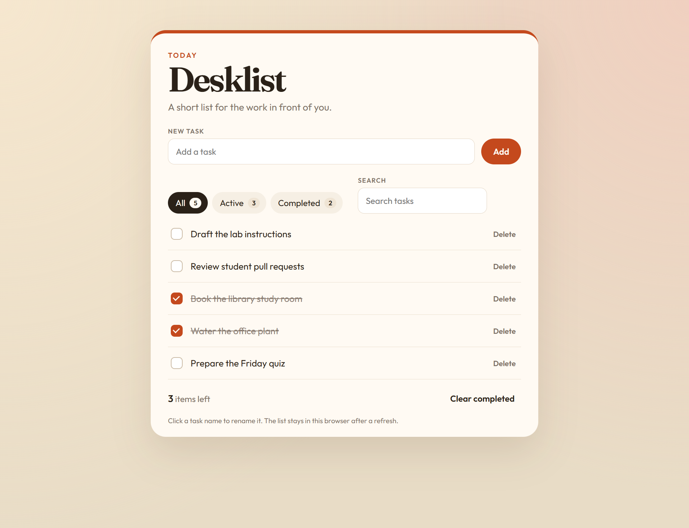
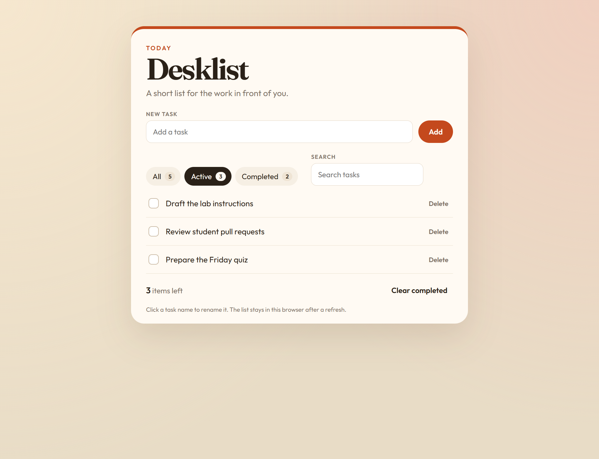
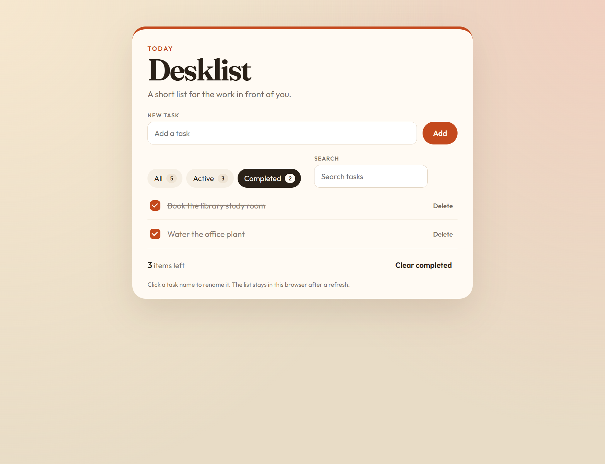
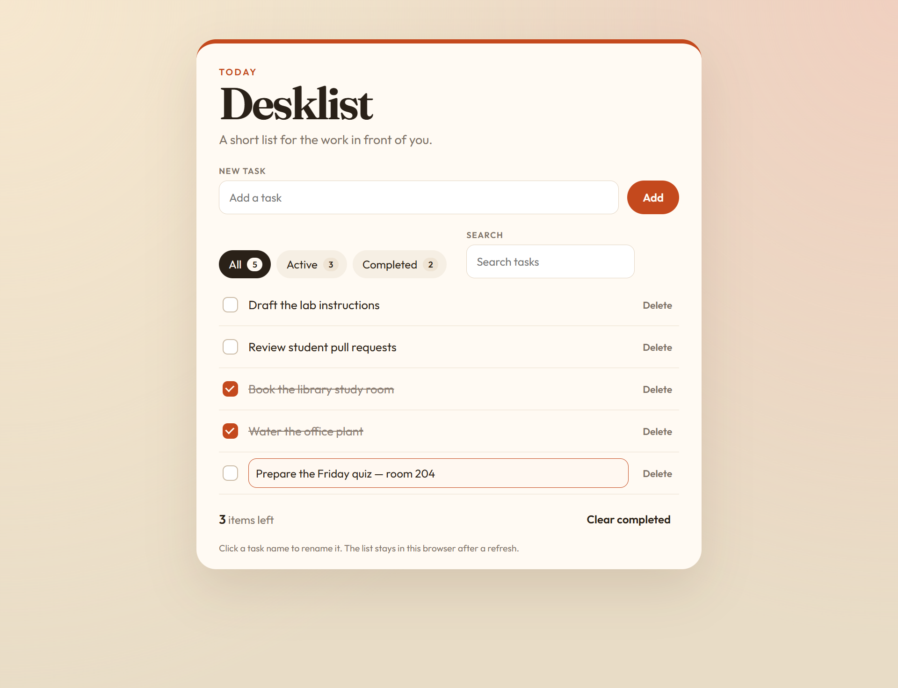
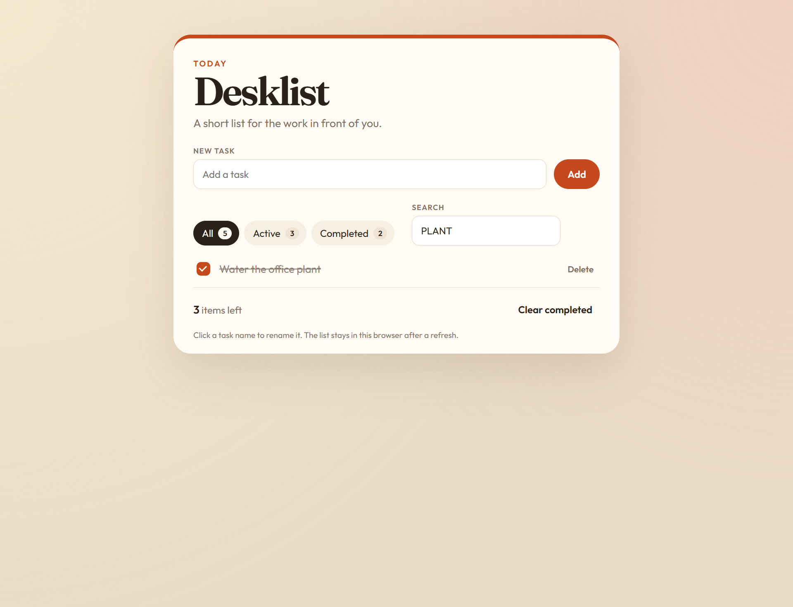
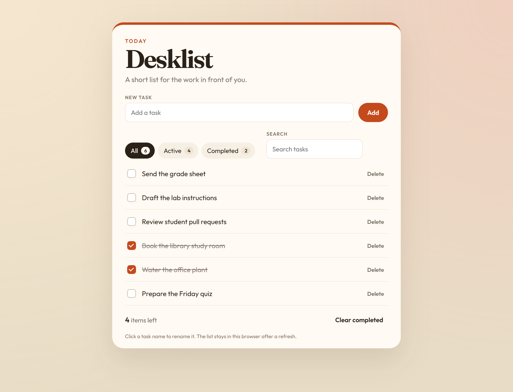
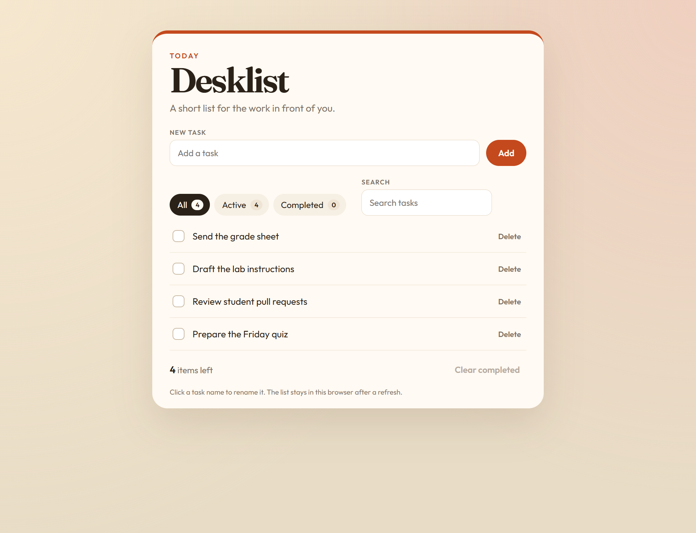
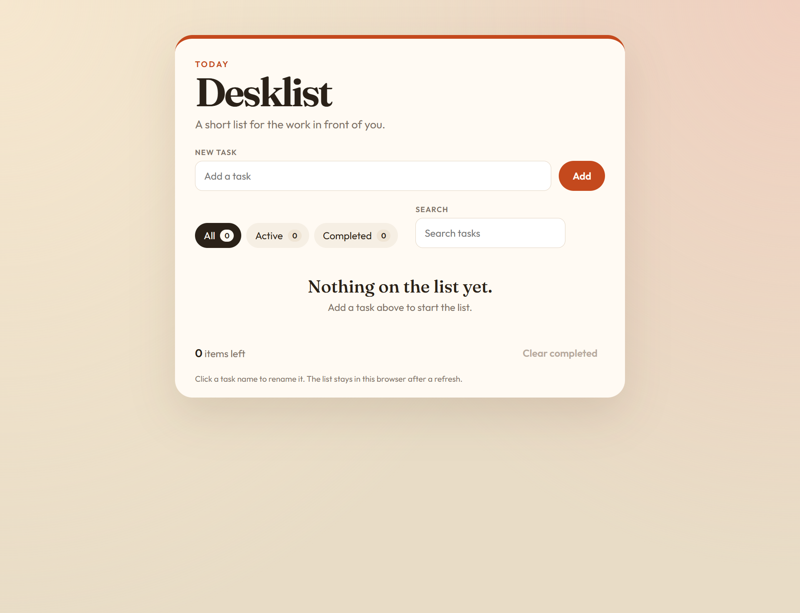

# Desklist debugging lab

Desklist is a small React todo app. This copy does not work. The screenshots in this folder are the finished app. Debug the code until your app matches those screens and the browser console is clean.

The lab is supposed to fail, then fail again in a new way. Fix the first error you can see, run it again, and repeat. You have to open every file in the table below. Compare the running app with the screenshots. Do not ask an AI to find the bugs, write the fixes, or write your journal.

## Setup

Install [Node.js 18](https://nodejs.org/) or newer, then in this folder run:

```bash
npm install
npm run dev
```

Open the local address Vite prints. It is usually `http://localhost:5173`.

## How to work

- Read the top red message, fix that crash, save, and look again. The next problem is often a different bug.
- Open the browser console as well. Some bugs throw, some only warn, and some fail quietly.
- After the list stays on screen, put the screenshots next to the app.
- Repair the files that are already here. Do not rewrite the app, and do not remove a feature to hide an error.
- Refresh while you test. The list has to survive a reload.
- When the app matches the screenshots, fill in `DEBUG_JOURNAL.md` yourself. One entry for every file you changed: what you saw, why it happened, what you changed, and how you checked it.

If a refresh brings back a red message about JSON, open DevTools, go to Application, then Local Storage, and delete the saved value for this site. Then look at how the list is saved.

## Starter tasks

On a fresh browser the list starts as:

1. Draft the lab instructions
2. Review student pull requests
3. Book the library study room, already completed
4. Water the office plant, already completed
5. Prepare the Friday quiz

## What the finished app does

- **Add.** Type a task and press Add or Enter. The task appears at the top. An empty task, including spaces only, is ignored.
- **Complete.** The checkbox stays checked, the words are crossed out, and the counts update immediately.
- **Rename.** Click a task name. Enter saves. Escape cancels. The new name stays on the row.
- **Delete.** Delete removes only that task.
- **Filters.** All, Active, and Completed show the matching tasks. The selected filter is the dark chip. The numbers on the chips count the whole list.
- **Search.** Search ignores capital letters. `PLANT` still finds "Water the office plant". The chip numbers do not change while you search. The "items left" count is the number of open tasks on the whole list, including tasks hidden by a filter or a search.
- **Clear completed.** This removes every finished task. If none are finished, the button is disabled.
- **Refresh.** The same tasks are still there.
- **Empty list.** Deleting everything shows "Nothing on the list yet." A filter or search with no matches shows "No tasks match this view."

## You are done when

- The page matches the screenshots below.
- A new task still works after you delete one, and its checkbox changes that task only.
- Refresh keeps your edits.
- The console has no errors and no warnings from this app.
- `DEBUG_JOURNAL.md` is filled in for every file you changed, in your own words.

## Screenshots

### 1. Starting list

All is selected. Three tasks are still open. Finished tasks are crossed out.



### 2. Active filter

Only the open tasks. The count at the bottom is still the whole list.



### 3. Completed filter

Only the finished tasks.



### 4. Renaming a task

Click the name and the row becomes a text box. This shot is before Enter. Enter saves. Escape puts the old name back.



### 5. Search

`PLANT` matches even though the task uses a lowercase p. The chip numbers stay 5, 3, and 2.



### 6. A new task

"Send the grade sheet" was added at the top. The open count is now 4.



### 7. Clear completed

After the task in screenshot 6, Clear completed removed both finished tasks. The button is then disabled.



### 8. Empty list


